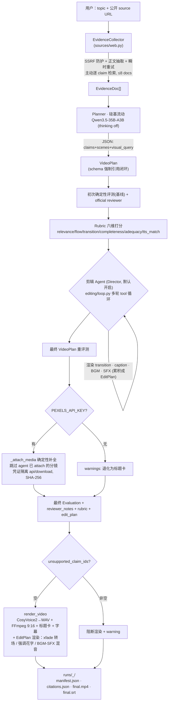

# TraceCut 项目大纲与路线（ROADMAP）

> 本文件是 TraceCut 的**唯一权威大纲**，统合定位、架构、亮点、研究问题、实现状态与推进节奏。`docs/` 下其余文件是历史附录，仅作背景。
> 
> - 迁移与删减审计：`migration_audit.md`
> - 早期生成方向调研：`research_report_video_editing_agent.md`、`project_direction_and_paper_plan.md`
> - TTS 评估 + 亮点/流程图：`tts_and_highlights.md`

最近更新：2026-08-07（剪辑 Agent 升级为 Director，默认开启；`--vl-loop` 内化进 Agent）。

---

## 1. 一句话定位

> **TraceCut：面向开放网页与可授权素材的、证据约束且全链路可追溯的自动短视频生成。**

用户给一个方向和若干公开来源，系统先建立 `claim → evidence → scene → material` 图，再生成旁白、检索 B-roll、合成竖屏短视频并自动审计。研究重点不是"能否出片"，而是**事实忠实度、视觉相关性、版权/来源可追溯性和制作预算能否同时成立**——把它们建模成可计算的 Pareto 前沿。

论文 pitch：

1. 现有自动短视频系统能生成流畅内容，但脚本事实、镜头选择和外部素材通常没有统一的可验证链路，导致事实漂移与素材责任边界不清。
2. TraceCut 用 claim-evidence-shot 图约束规划与检索，并在产物中保留逐镜溯源与自动审计，使系统可显式优化忠实度、画面匹配、可追溯性与成本。

## 2. 应用分支：谣言判别（共享骨架，不作主线）

TraceCut 的 claim-evidence-reviewer 骨架天然可复用于"社交媒体谣言判别"：拆 atomic claim → 逐 claim 主动检索证据 → 逐 claim 判别（SUPPORT/REFUTE/UNVERIFIABLE）+ 归因。`tracecut/judge.py` + `tracecut judge` CLI 已跑通，纯免费检索路径下 8 条样本 7 条判别正确（见 `experiments/SAMPLE_REPORT.md`）。

**定位**：这是生成骨架的**应用分支**，不是项目主线。它验证了骨架的通用性，并为生成方向反哺了更强的证据召回能力（正文抽取、主动检索、中英双语 Wikipedia）。判别不进生成方向的主指标；如未来判别方向独立成文，再单列。

## 3. 刻意不做什么

- 不复制任何上游项目的攻击性叙事、安全逃逸或虚构新闻提示词。
- 不连接任何内网服务；本项目是通用项目，所有外部 API 走公网。
- 不从未知版权的平台批量抓取视频；不把模型生成的"合成搜索结果"伪装成证据。
- 不把"多智能体编排"当作贡献（MovieAgent/Sima/CutClaw 已覆盖）。
- 不研究像素级视频重绘 / 文生视频生成（研究对象仅"开放证据 + 外部素材驱动的短视频组装"）。
- 不依赖收费搜索 API 作为最小可跑路径（Brave 等保留为可选增强）。

## 4. 核心亮点

1. **全链路可追溯的证据约束图**：`claim → evidence → scene → material` 为一等公民，Pydantic schema 强制引用闭环（场景引用的 claim 必须存在、场景 evidence 必须附着于其 claim、claim evidence 必须来自真实抓取的 `EvidenceDoc`）。断链时自动阻断渲染，产物不会携带无来源事实。
2. **事实忠实度优先于"像不像视频"**：输出 `claim_provenance_coverage`、`scene_evidence_coverage`、`media_coverage`、`unsupported_claim_ids` 等结构化溯源覆盖指标，把"事实漂移"变成可计算维度。
3. **文本证据与视觉素材分离建模**：每镜同时标记 `evidence_ids`（事实来源）与 `material_id`（视觉素材），禁止把 stock footage 当事实来源——既支撑生成方向的镜头支持性，也为误导性画面识别提供结构基础。
4. **主动证据检索**：拆 claim 后逐 claim 检索证据源（纯免费中英双语 Wikipedia + LLM 查询改写，可选 Brave 增强），不依赖用户给 URL。生成与判别共享此能力。
5. **一致的模型链路**：默认通过硅基流动服务 `Qwen/Qwen3.5-35B-A3B`，也支持接入自有 OpenAI 兼容网关作 reviewer 回退。
6. **安全边界内建且被测试守护**：所有 HTTP 客户端 `trust_env=False`、SSRF 防护、Pexels 凭证隔离、模型输出经 schema 校验。`test_security.py` 守护不变量。
7. **产物即论文素材**：每次运行产出 `manifest.json`（计划+证据+评测+警告+provider 溯源）与 `citations.json`，天然支撑"逐镜溯源、自动审计"的论文叙事。

## 5. 架构与流程

### 5.1 生成 pipeline（主线）



### 5.2 数据模型与引用约束（不变量）

```text
EvidenceDoc (真实抓取)
   ▲
   │ evidence_ids (必须存在于已抓取集合，否则 → unsupported)
Claim
   ▲
   │ claim_ids (必须存在)
Scene ─── evidence_ids (必须 ⊆ 该场景 claim 的 evidence 并集)
   │
   └── material (Pexels, 仅作视觉素材, 不作事实来源)

校验失败 → unsupported_claim_ids 非空 → 渲染自动阻断
```

### 5.3 Reviewer 网关链路

Reviewer 永远执行：优先使用配置的自有 OpenAI 兼容网关（`VENUS_BASE_URL`，可选）；未配置或失败 → 回退 SiliconFlow；两者都失败 → 抛错（不降级）。默认只启用 SiliconFlow。

### 5.4 模块映射

| 阶段       | 模块                                     | 说明                                                                                                                                |
| -------- | -------------------------------------- | --------------------------------------------------------------------------------------------------------------------------------- |
| 证据收集     | `sources/web.py` + `sources/search.py` | 主动逐 claim 检索（中英 Wikipedia + 可选 Brave），SSRF 防护、正文抽取、瞬时重试                                                                           |
| 规划       | `planner.py` + `providers/llm.py`      | SiliconFlow，`enable_thinking=False`，内容驱动时长，自愈重试                                                                                   |
| 素材       | `sources/pexels.py`                    | api/download 客户端凭证隔离，SHA-256 留痕                                                                                                   |
| 评测       | `evaluate.py` + `rubric.py`            | 确定性结构覆盖 + reviewer 审判 + 六维 rubric 打分                                                                                              |
| 剪辑 Agent (Director) | `editing/`（loop/tools/plan）          | 默认开启（`--rubric-iters 2`，可 `0` 关）。rubric 低分驱动多轮 tool 循环，是管线"导演"：①内容软编辑 + `add_scene`/`remove_scene`（只引已有 claim/evidence，守 provenance）；②**B-roll 负责制**——`search_broll`/`attach_broll`/`rerank_broll`(VL rerank，吸收旧 `--vl-loop`)；③渲染决策（转场/花字/BGM/SFX）→ `EditPlan`；tool-calling 不支持或失败时降级单次 JSON / 空 Plan，永不阻断 pipeline |
| 渲染       | `media.py` + `tts.py`                  | CosyVoice2 TTS（硅基流动 API，无需 GPU）+ FFmpeg 9:16 + 标题卡 + 字幕                                                                           |
| 编排       | `pipeline.py`                          | 单 pipeline，无多智能体层                                                                                                                 |
| 谣言判别（分支） | `judge.py`                             | 复用骨架做 claim 判别 + 归因，`tracecut judge` CLI                                                                                          |
| 契约       | `schemas.py`                           | Pydantic 图校验，ID 正则兼作路径逃逸防护                                                                                                        |
| 入口       | `cli.py`                               | `tracecut doctor / run / judge`                                                                                                   |

## 6. 研究问题

### RQ1：显式 claim-evidence-shot 图能否减少事实漂移？

- Baseline A：topic → LLM 脚本 → 素材检索。
- Baseline B：把检索文档直接放入 prompt（普通 RAG）。
- Ours：先抽 claim 并绑定 evidence，再规划 scene 和 visual query；不支持的 claim 禁止进入旁白。
- 指标：Claim Support Precision/Recall、Attribution Accuracy、Unsupported Claim Rate、人工事实核验。

### RQ2：文本证据与视觉素材分离建模，能否提升镜头支持性？

- 每镜同时标记 `evidence_ids` 与 `material_id`，禁止把 stock footage 当事实来源。
- Baseline：CLIP/文本相似度选 B-roll；或确定性 `_attach_media` 起底片。
- Ours：claim-aware query + 场景意图 + 多样性/重复惩罚 + provenance constraints，**由剪辑 Agent 做主**——relevance/misleading 低分时 `search_broll` → `rerank_broll`(VL) → `attach_broll` 换素材。
- 指标：Scene-Text Alignment、Claim-Visual Support、Misleading Visual Rate、重复率、人工偏好。

### RQ3：独立审判 + 预算约束 + rubric 驱动的剪辑 Agent 能否在低额外成本下提升可靠性？

- Planner：硅基流动（默认 `Qwen/Qwen3.5-35B-A3B`，thinking 关闭）。
- Reviewer：可选自有网关首选，回退 SiliconFlow，不降级。
- Rubric：六维打分。
- 剪辑 Agent：吃 rubric 低分反馈，做内容软编辑 + `add_scene`/`remove_scene`（守 provenance）+ B-roll 重选（search/attach/rerank，内化旧 `--vl-loop`）+ 渲染决策（转场/花字/BGM/SFX）。对比`--rubric-iters 0`（Agent off，纯起底片）/ `--rubric-iters 2`（Agent on），看 polished + 镜头支持收益是否超过 token 成本。
- 比较：无 reviewer / self-review / cross-review；Agent off / Agent on。
- 指标：错误检出率、修正收益（rubric 分前后差）、polished 决策数、B-roll 更换数与 VL 分前后差、调用次数、token 成本、端到端时延。

## 7. 当前实现状态（2026-07-21）

### 生成方向（主线）

`tracecut/` 已实现最小研究原型并端到端跑通：

- ✅ 硅基流动 provider adapter（默认模型 `Qwen/Qwen3.5-35B-A3B`，thinking 关闭）；
- ✅ 不继承网络代理（`trust_env=False`）；
- ✅ 主动证据收集（中英双语 Wikipedia + LLM 查询改写 + 可选 Brave，正文抽取修复，瞬时 403 重试）；
- ✅ claim-evidence-scene 结构化规划 + planner 自愈重试 + 内容驱动时长（不硬卡目标）；
- ✅ Pexels 搜索、下载、许可 URL 与 SHA-256；
- ✅ 确定性 provenance coverage；
- ✅ Reviewer 始终运行（可选自有网关 → SiliconFlow 回退，不降级）；
- ✅ CosyVoice2 TTS（硅基流动 API，24kHz，无需 GPU），macOS `say` 离线 fallback；
- ✅ Rubric 六维打分（relevance/flow/transition/completeness/adequacy/tts_match）；
- ✅ **剪辑 Agent（Director，`editing/`，默认开启 `--rubric-iters 2`）**：取代旧的"rubric 软编辑"内嵌路径。**管线围绕它重组**：rubric 只负责打分，剪辑 Agent 吃 rubric 低分反馈做多轮 tool 循环，三类决策全都走 `check_soft_edit_invariants` 守卫——①**内容/结构**：title/hook、narration/visual_query、`reorder`，并新增 `add_scene`/`remove_scene`（只允许引用计划里已有的 claim/evidence，可重构但不能扩展事实面，`min/max_scenes` 卡规模）；②**B-roll 负责制**：`search_broll`/`attach_broll`/`rerank_broll`(VL rerank)，把旧的 `--vl-loop` 固定逻辑搬进 Agent，由它决定要不要换素材、换哪条（缺 VL provider 时降级成只找不 rerank；无 Pexels key 时素材工具不注册）；③**渲染决策**累积成 `EditPlan`：xfade 转场（fade/slideleft/slideright/wipeleft/circleopen，≤0.8 s 旁白尾静音内）、drawtext 花字、BGM（`-stream_loop` 全片低音量混音）、SFX。资产白名单来自 `TRACECUT_BGM_DIR`/`TRACECUT_SFX_DIR`（默认打包 `assets/bgm|sfx`，显式设为空则禁用），无资产时不注册对应 tool。降级阶梯：tool 循环 → 单次结构化 JSON（同一套守卫回放）→ 空 EditPlan 不修改，**任何失败都不阻断出片**。`EditPlan` 挂 `VideoPlan.edit`（Optional，默认 None，旧 manifest 兼容），渲染时由 `media.py` 落到 FFmpeg；管线侧把初次 `_attach_media` 移到 Agent **之后**（用 Agent 改好的 visual_query 起底片），并跳过 Agent 已 attach 的分镜、做跨分镜去重；
- ✅ 标题卡 + 字幕样式（CJK 字体探测，按中文标点断句不割词）；
- ✅ **VL 视觉评判**：`vl_judge.py` 用 Qwen3-VL 对渲染帧打"画面-旁白相关性"分（1–5）+ `misleading_visual` 标记（RQ2 误导画面信号），补了 rubric 只有文本维度的洞；报告进 `manifest.json` 的 `vl` 字段。其 `rerank_candidates` 已被剪辑 Agent 的素材工具复用——旧的固定 `--vl-loop` 已内化进 Agent，CLI 不再单独暴露这个 flag；
- ✅ `manifest.json` 和 `citations.json`。

样本（见 `tracecut/runs/` 与 `experiments/category_matrix/summary.json`）：6 类主题 × baseline/director 双配置矩阵已全绿端到端。当前 Director 默认开（`--rubric-iters 2`）：素材选题（`media_cov`）两条路径均 1.0，VL 多数维度过 4；多数 run 在 iter 0 即 `rubric ≥4.8` 无需再改（编辑 Agent 首轮就过）。**已知短板**：抽象/技术类（大型语言模型、疫苗）仍是 VL 评判的痛点——候选 rerank 多为 1–2 分，即便 Agent 主导也未必能换到更准的画面；transitions/花字/字幕样式仍简陋（剪辑 Agent 已有能力但用得保守）。

### 谣言判别分支

- ✅ `judge.py` + `tracecut judge` CLI：claim 拆解 → 查询改写 → 主动检索 → 判别 + 归因；
- ✅ 8 条样本 7 条判别正确（真/假/不可证），见 `experiments/SAMPLE_REPORT.md`；
- 已知误判：模糊因果 claim 的 over-attribution（咖啡案），需更严格判别 prompt。

### 待办（生成方向优先）

1. **VL 闭环（现由剪辑 Agent 驱动）扩样本验证**：剪辑 Agent 已接管 `search_broll/rerank_broll/attach_broll`，但在抽象 AI 主题上 rerank 顶分仍常滞留 1–2 分、换不到更清晰素材。需扩样本量、调阈值/换更具体的 query 改写策略，验证 Agent 主导的重选能否稳定提升视觉相关性。
2. **转场/字幕细化**：剪辑 Agent 已能做 xfade 转场、drawtext 花字、BGM/SFX（带打包默认资产），subtitle 样式仍基础；转场只在情绪转折节拍使用，多数切点保持硬切。
3. **生成质量评测**：定义 Scene-Text Alignment、Claim-Visual Support 等指标，扩样本量（与 baseline/director 矩阵对齐）。
4. OpenShorts-100 数据集与人工标注。

## 8. 推进节奏

### Pilot

- 完成 10 个主题、每个 3 个来源。
- 比较普通 RAG 与 claim 图约束，先只评事实支持率。
- 人工检查 100 个 claims；若不能显著降低 unsupported claim，停止扩展。

### System study

- 加入 VL B-roll rerank 和误导性画面标签。
- 扩到 50–100 个主题，形成 OpenShorts-100。
- 完成三组主实验和消融，报告成本。

### Paper framing

优先考虑多媒体/人机协作/应用型方向，而不是包装成基础视频生成模型。若数据集和评测足够扎实，强调 benchmark + system；若训练出有效的 claim-aware multimodal ranker，则强调 method + dataset。

## 9. 最强反对意见

**"这只是 RAG + Pexels + FFmpeg 的系统拼装。"**

回应不靠"多智能体"或工程复杂度。只有在以下至少一项成立时才构成论文：

1. claim-evidence-shot 表示带来稳定、显著、可复现的事实与视觉支持收益；
2. 提出可靠的新评测/数据集，揭示现有自动成片系统的系统性失败；
3. 提出可训练或可优化的 grounded clip ranker / budget-aware controller，超越简单 prompt pipeline。

因此首个实验必须验证核心表示是否产生可测价值，而不是先堆更多 Agent。

## 10. 近邻工作边界

- **REGen（2025, arXiv:2505.18880）**：单长纪录片→带可引用片段 teaser；我们边界是开放网页证据 + 跨库 stock footage，并把文本事实证据与视觉素材来源分开建模。
- **Sima 1.0（2026）**：多智能体纪录片制作含公共 B-roll；我们重点是逐 claim/逐镜 provenance 与可度量审计。
- **CutClaw（2026）**：长原始素材→音乐同步短视频；我们输入是方向+开放来源，不是同一拍摄素材池。
- **AgenticVBench（2026）**：真实后期任务基准，要求 provenance/license metadata；任务设计与评测协议的参照。
- **DirectorBench（2026）**：长视频生成多智能体评测；借鉴 checkpoint 诊断。

不能声称"首个自动短视频 Agent"或"首个会检索素材的系统"。可谨慎主张：

> 首批系统化研究开放域、证据约束的短视频组装，并联合评测事实证据、镜头素材来源、视觉支持与预算。

正式投稿前仍需用 Semantic Scholar/CrossRef 复核版本、作者、venue 与 BibTeX。
