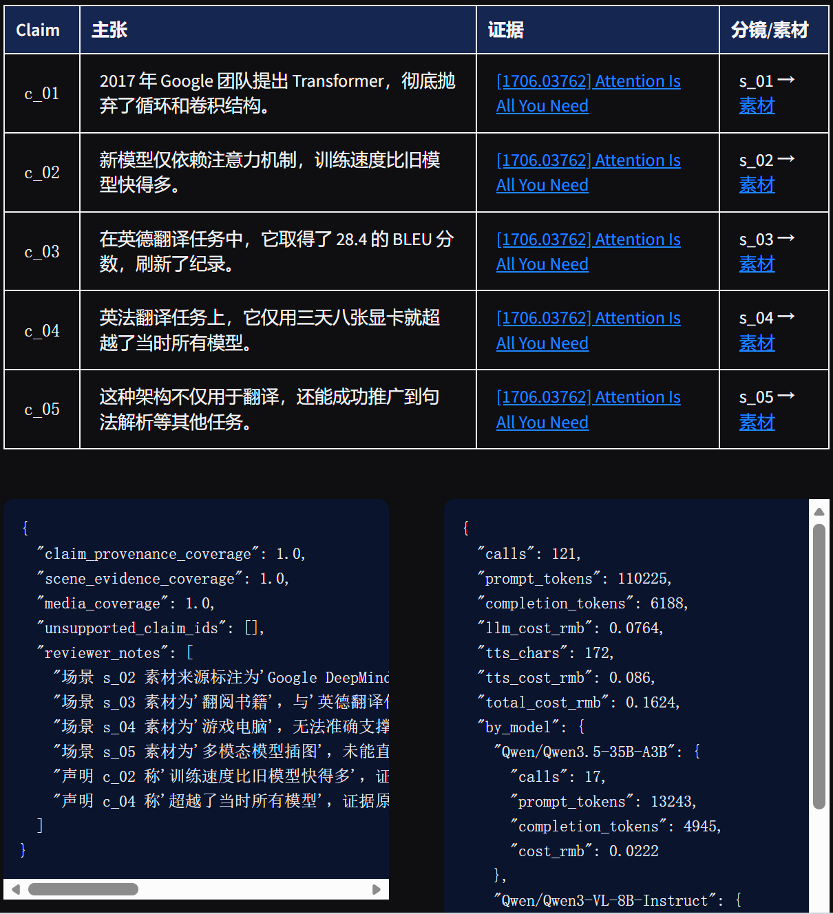
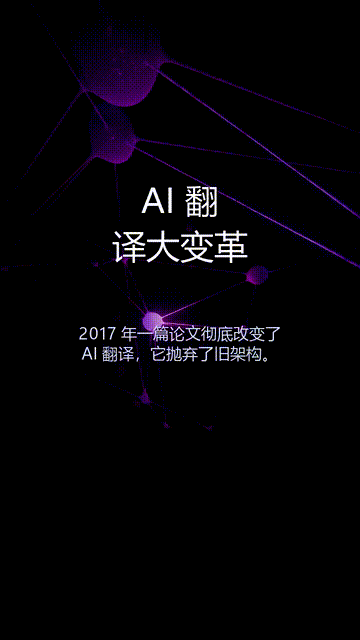
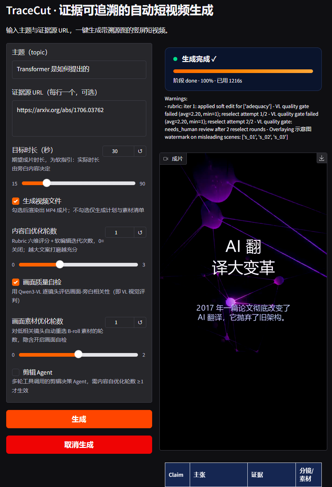

<div align="center">

# TraceCut

**证据约束 · 全链路可追溯** 的自动短视频生成

[]()
[]()
[]()
[]()

</div>

---

**TraceCut** 面向开放网页与可授权素材，把自动成片从"生成一个像视频的东西"升级为"生成一个**每个事实、镜头、素材都可追溯**的产物"。给定方向与公开来源，系统先建立 `claim → evidence → scene → material` 图，再生成旁白、检索 B-roll、合成竖屏短视频并自动审计——研究重点是**事实忠实度、视觉相关性、来源可追溯性与制作预算能否同时成立**，把它们建模成可计算的 Pareto 前沿。

## ✨ 核心特性

- **证据约束图**：`claim → evidence → scene → material` 为一等公民，引用闭环，断链自动阻断渲染。
- **事实忠实度优先**：输出结构化溯源覆盖指标，把"事实漂移"变成可计算维度，而非依赖 prompt 恳求。
- **文本证据与视觉素材分离**：每镜同时标记事实来源与视觉素材，禁止把 stock footage 当事实来源。
- **主动证据检索**：逐 claim 检索证据（中英 Wikipedia + 可选 Brave），不依赖用户给全 URL。
- **剪辑 Agent + VL 视觉评判**：多轮工具循环（内容软编辑 / B-roll 重选 / 渲染决策）+ 视觉大模型画面相关性打分。
- **可复用骨架**：同一骨架支撑**谣言判别**分支（`tracecut judge`），逐 claim 判别 + 归因。
- **安全边界内建**：SSRF 防护、凭证隔离、模型输出经 schema 校验。

> 项目定位与路线见上级目录 `docs/ROADMAP.md`。

## 🚀 快速开始

```bash
# ① 安装（Python 3.11+，需 FFmpeg）
cd tracecut && pip install -e '.[dev]'

# ② 配置密钥（模板见 tracecut/.env.example）
export SILICONFLOW_API_KEY="sk-xxx"
export PEXELS_API_KEY="xxx"

# ③ 自检
tracecut doctor

# ④ 生成第一条竖屏短视频（约几分钟）
tracecut run "Transformer 是如何提出的" \
  --source-url "https://arxiv.org/abs/1706.03762" \
  --render
```

## 研究定位

普通自动成片系统优化"像不像一个视频"；TraceCut 优先研究"每个事实、镜头和素材能不能追溯"。核心产物不是单独的 MP4，而是可审计的结构化产物：

- `manifest.json`：计划、claim、证据、镜头、素材、评测、警告与 provider 溯源；
- `citations.json`：公开来源清单；
- `final.mp4` / `final.srt`：渲染结果（可选）。

## 架构

```text
公开证据 URL / 主动检索（中英 Wikipedia + 可选 Brave）
        ↓
EvidenceCollector ── SSRF 防护 + 正文抽取 + 瞬时重试
        ↓
Planner（硅基流动 Qwen3.5-35B-A3B）→ claims + scenes + visual queries
        ↓                                ↓
Reviewer（Venus→硅基流动回退）     PexelsSource（凭证隔离）
        ↓                                ↓
provenance audit                material URL/license/SHA-256
        ↓                                ↓
Rubric 六维自迭代（可选）         VL 视觉评判 + B-roll 重选闭环（可选）
        └──────────────┬─────────────────┘
                       ↓
          CosyVoice2 TTS → FFmpeg 9:16 + 标题卡 + 字幕
                       ↓
            manifest.json + citations.json + final.mp4/srt
```

### 模块映射

| 阶段 | 模块 | 说明 |
|---|---|---|
| 证据收集 | `sources/web.py` + `sources/search.py` | 主动逐 claim 检索（中英 Wikipedia + 可选 Brave），SSRF 防护、正文抽取、瞬时重试 |
| 规划 | `planner.py` + `providers/llm.py` | SiliconFlow OpenAI-compatible，`enable_thinking=False`，内容驱动时长，自愈重试 |
| 素材 | `sources/pexels.py` | api/download 客户端凭证隔离，SHA-256 留痕 |
| 评测 | `evaluate.py` + `rubric.py` | 确定性结构覆盖 + reviewer 审判 + 六维 rubric 自迭代 |
| 视觉评判 | `vl_judge.py` | Qwen3-VL 对渲染帧打"画面-旁白相关性"分 + B-roll 候选 rerank |
| 渲染 | `media.py` + `tts.py` | CosyVoice2 TTS（硅基流动 API，无需 GPU）+ FFmpeg 9:16 + 标题卡 + 字幕 |
| 谣言判别（分支） | `judge.py` | 复用骨架做 claim 判别 + 归因，`tracecut judge` CLI |
| 契约 | `schemas.py` | Pydantic 图校验，ID 正则兼作路径逃逸防护 |
| 入口 | `cli.py` | `tracecut doctor / run / judge` |

## 安装与配置

需要 Python ≥ 3.11、FFmpeg（含 ffprobe）。推荐用 venv：

```bash
cd tracecut
python3 -m venv .venv
source .venv/bin/activate          # Windows: .venv\Scripts\activate
pip install -e '.[dev]'
```

关键环境变量（完整模板见 `tracecut/.env.example`，已有密钥无需复制进仓库）：

| 变量 | 必需 | 说明 |
|---|---|---|
| `SILICONFLOW_API_KEY` | 是 | 规划 / TTS / 视觉评判的默认网关密钥 |
| `PEXELS_API_KEY` | 否 | 可授权 B-roll 素材；缺失时退化为标题卡 |
| `BRAVE_API_KEY` | 否 | 通用搜索增强；缺失时退化为中英 Wikipedia（免费） |

## 生成短视频

仅生成计划与素材清单（不渲染）：

```bash
tracecut run "Transformer 是如何提出的" \
  --source-url "https://arxiv.org/abs/1706.03762"
```

生成并渲染竖屏视频：

```bash
tracecut run "Transformer 是如何提出的" \
  --source-url "https://arxiv.org/abs/1706.03762" \
  --duration 30 --render
```

常用 `run` 选项：

- `--source-url`（可多次）：种子证据 URL；未给则用主动检索补全。
- `--duration`：目标时长（软指引，成片时长由旁白实际长度决定）。
- `--no-media`：不下载素材，镜头退化为标题卡。
- `--rubric-iters N`：开启六维自迭代（最多 N 轮软编辑）。
- `--vl`：渲染后视觉评判每镜画面-旁白相关性。
- `--vl-loop N`：低相关镜头自动重选素材（最多 N 轮，仅在候选更优时才换）。

产物在 `runs/<slug>_<id>/`：`manifest.json`、`citations.json`、`final.mp4`、`final.srt`。

## 🎬 Demo

**溯源图**：



**成片预览**：



**Gradio 交互界面**：



## 谣言判别（应用分支）

```bash
tracecut judge "2024 年诺贝尔物理学奖颁发给了 John Hopfield 和 Geoffrey Hinton，表彰他们在人工神经网络和机器学习方面的基础性发现。"
```

产出逐 claim 的 verdict（SUPPORT/REFUTE/UNVERIFIABLE）、引用的证据与理由，以及 overall 汇总。纯免费检索路径即可跑通；可选配 `BRAVE_API_KEY` 增强召回。

## 当前限制

- 公开网页检索默认走"用户 URL + 中英 Wikipedia"；接入 `BRAVE_API_KEY` 可增强。
- Pexels 提供可复用许可，但 stock footage 只能语义相关，不能作为事实证据；抽象/技术主题的素材匹配率有限。
- 自动评测（provenance coverage / rubric / VL）不能替代人工对事实正确性、叙事质量与版权合规的审核。

## 🤝 贡献指南

欢迎提交 issue 与 PR。提交前请：

1. **通过 lint 与测试**：`ruff check src tests && pytest -q`。
2. **守住 provenance 不变量**：改动 `schemas.py` 时，需同步更新 planner 的 prompt 与校验逻辑；安全边界由 `tests/test_security.py` 守护。
3. **不提交任何密钥**：`.env` 已被 `.gitignore` 排除，请勿在代码、文档或日志中硬编码 API key。
4. **清晰的提交信息**：建议遵循 conventional commits（`feat:` / `fix:` / `docs:` 等）。

### 依赖归属

- 核心依赖 → `tracecut/pyproject.toml`；
- 服务层依赖 → `serve/requirements.txt`（gradio 锁定 `>=5.0,<6`）。

## 许可

研究原型，仅供学术研究使用。外部依赖（SiliconFlow / Pexels / Brave / Wikipedia 等）各自受其服务条款约束。
